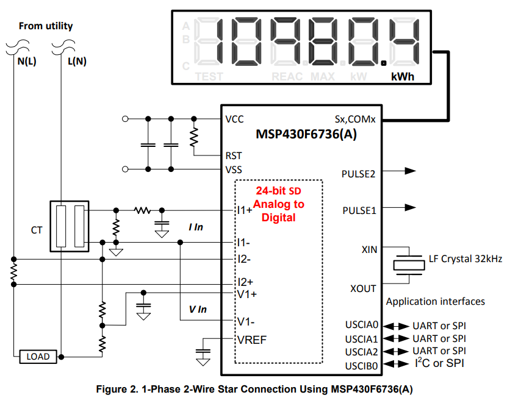

# 보안등 전력계측기(MSP430F6736A) 문서

## Table of Contents

- [Introduce](#introduce)
- [Feature](#feature)
- [Protocol](#protocol)

## Introduce

보안등 점멸기는 2개의 MPU가 통합된 일체형의 제품이며 이 문서는 전력계측기 역할을 하는
MSP430F6736A에 대해서만 작성한다.

## Feature

MSP430F6736A로 측정가능한 목록은 아래와 같다.

- Voltage RMS
- Voltage Peak
- Current RMS
- Current Peak
- Power Factor
- Frequency
- Phase Angle
- Active Power, Energy
- Reactive Power, Energy
- Apparent Power, Energy

## Protocol

<a href="./documents/보안등_프로토콜_설계서.doc" Download>Protocol Document</a>
